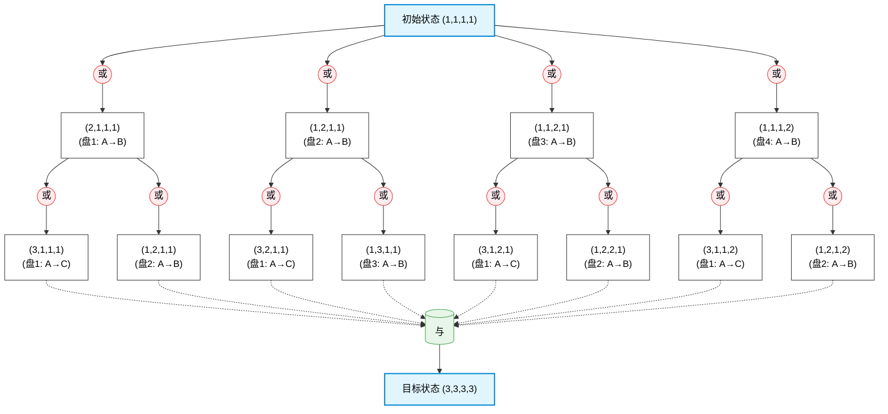
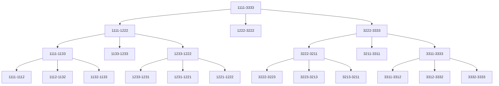

## 一、多选题

1. 本原问题所对应的节点称为___________ **【 正确答案: B 】**
    
    - A. 端节点
        
    - B. 终叶节点
        
    - C. 子节点
        
    - D. 父节点
        
2. 基于状态空间的搜索算法是___________ **【 正确答案: A 】**
    
    - A. $A^*$算法
        
    - B. 与或树搜索
        
    - C. 极大极小分析法
        
    - D. $\alpha-\beta$剪枝技术
        
3. 关于状态描述正确的是___________ **【 正确答案: AB 】**
    
    - A. 描述事物的一组最少变量 $q_0, q_1, \dots, q_n$ 的有序集合
        
    - B. 表示问题求解法中每一步问题状况的数据结构
        
    - C. 把问题从一种状态变换为另一种状态的手段集合
        
    - D. 状态可以是走步、过程、规则、数学算子、运算符号或逻辑符号等
        
4. 状态空间的三元组 $(S, F, G)$ 代表___________ **【 正确答案: C 】**
    
    - A. 算子符号，初始状态集，目标状态集
        
    - B. 目标状态集，初始状态集，算子符号
        
    - C. 初始状态集，算子符号，目标状态集
        
    - D. 初始状态集，目标状态集，算子符号
        
5. 博弈树算法包括___________ **【 正确答案: CD 】**
    
    - A. $A^*$算法
        
    - B. 与或树搜索
        
    - C. 极大极小分析法
        
    - D. $\alpha-\beta$剪枝技术
        

## 二、填空题

1. 从问题的初始状态集，经过一系列的字符运算，到达目标状态，所经过字符的序列叫______ **【 正确答案: 问题的解 】**
    
2. 搜索是______ **【 正确答案: 在问题的解空间(或状态空间)中，通过不断使用算子(操作)寻找一条从初始状态通往目标状态的路径(或解)的过程，根据问题的实际情况，不断寻找可利用知识，从而构造一条代价最小的推理路线，使问题得到解决的过程 】**
    
3. 把一个复杂问题分解或变换为一组本原问题的过程称作______ **【 正确答案: 问题归约 】**
    
4. ______ **【 正确答案: 解图 】** 可解节点的子图，这些节点能够证明其初始节点是可解的
    

## 三、判断题

1. 终叶节点一定是端节点，但端节点不一定是终止节点 **【 正确答案: 正确 】**
    
2. 将一个复杂的问题分解为几个子问题的过程称为分解。可用或树表示，将一个复杂的问题变换成若干等价的问题的过程称为等价变换。可用与树表示 **【 正确答案: 错误 】**
    
3. 智能搜索与搜索的区别在于可以利用搜索过程中的信息来引导搜索项向最优方发展 **【 正确答案: 正确 】**
    
4. 本原问题不需要再进行分解或变换便可以直接解决 **【 正确答案: 正确 】**
    
5. 问题归约从目标问题出发，将目标问题分解成若干子问题，直至最后把初始问题归约为本原问题集合 **【 正确答案: 正确 】**
    
6. 状态空间方法是以状态和字符为基础来表示和求解问题的知识表示方法 **【 正确答案: 正确 】**
    

## 四、简答题

1. **试用四元数组结构表示四圆盘梵塔问题，并画出求解问题的与或图**
    
    - **提交的解答内容：** 设四个圆盘从小到大编号为 1、2、3、4，$A, B, C$ 表示三根柱子。 用四元数组 $(x_1, x_2, x_3, x_4)$ 表示状态，其中每个数字表示对应圆盘所在的柱子，$A, B, C$ 分别用 $1, 2, 3$ 表示。
        
        **与或图表示（Mermaid）：**
        

- **参考答案（问题归约求解图）：**
    

2. **状态空间图与与或图有什么区别及联系？**
    
    - **提交的解答内容：** 状态空间图表示问题所有可能的状态，以及状态之间的转换关系。 与或图表示问题的求解过程。“或”表示有多种选择，选一种即可；“与”表示有多个子问题，必须全部解决。 它们的联系是：都可以用图表示问题的求解过程。状态空间图侧重状态之间的转换，与或图侧重问题之间的选择和分解。
        
    - **参考答案：** 状态空间图可以看成与或树的一个特例，即只有或树，没有与树。
        

3. **有一农夫带一条狼，一只羊和一框青菜与从河的左岸乘船倒右岸**
    
    - **提交的解答内容：**
        
        **状态按 (农夫, 狼, 羊, 菜) 排列；0=左岸，1=右岸。**

```mermaid
%%{init: {'theme':'base', 'themeVariables': {'primaryTextColor':'#000000', 'secondaryTextColor':'#000000', 'tertiaryTextColor':'#000000', 'textColor':'#000000', 'lineColor':'#333333', 'edgeLabelBackground':'#ffffff'}}}%%
graph LR
    S0["(0,0,0,0)<br/>初始状态"] -- "农夫带羊过河" --> S1["(1,0,1,0)"]
    S1 -- "农夫独自返回" --> S2["(0,0,1,0)"]
    S2 -- "农夫带狼过河" --> S3["(1,1,1,0)"]
    S3 -- "农夫带羊返回" --> S4["(0,1,0,0)"]
    S4 -- "农夫带菜过河" --> S5["(1,1,0,1)"]
    S5 -- "农夫独自返回" --> S6["(0,1,0,1)"]
    S6 -- "农夫带羊过河" --> S7["(1,1,1,1)<br/>目标状态"]

    style S0 fill:#e1f5fe,color:#000000,stroke:#0288d1
    style S7 fill:#e1f5fe,color:#000000,stroke:#0288d1

    classDef default fill:#ffffff,color:#000000,stroke:#333333,stroke-width:1px;
    linkStyle default stroke:#333333,stroke-width:1px;
```
        

**安全规则：** 狼不能单独和羊在一起；羊不能单独和菜在一起。

- **参考答案：**
    
    **第一步，定义问题的描述形式。** 用四元组 $S = (f, w, s, v)$ 表示问题状态，其中 $f, w, s, v$ 分别表示农夫，狼，羊和青菜是否在左岸，它们都可以取 $0$ 或 $1$，$1$ 表示在左岸，$0$ 表示在右岸。
    
    **第二步，用所定义的问题状态表示方式，把所有可能的问题状态表示出来，包括问题的初始状态和目标状态。**
    
    由于状态变量有 4 个，每个状态变量都有 2 种取值，因此有以下 16 种状态：
    
    - $S_0 = (1, 1, 1, 1)$, $S_1 = (1, 1, 1, 0)$, $S_2 = (1, 1, 0, 1)$, $S_3 = (1, 1, 0, 0)$  
        
    - $S_4 = (1, 0, 1, 1)$, $S_5 = (1, 0, 1, 0)$, $S_6 = (1, 0, 0, 1)$, $S_7 = (1, 0, 0, 0)$  
        
    - $S_8 = (0, 1, 1, 1)$, $S_9 = (0, 1, 1, 0)$, $S_{10} = (0, 1, 0, 1)$, $S_{11} = (0, 1, 0, 0)$  
        
    - $S_{12} = (0, 0, 1, 1)$, $S_{13} = (0, 0, 1, 0)$, $S_{14} = (0, 0, 0, 1)$, $S_{15} = (0, 0, 0, 0)$  
        
    
    其中，状态 $S_3, S_6, S_7, S_8, S_9, S_{12}$ 是不合法状态，$S_0$ 和 $S_{15}$ 分别是初始状态和目标状态。
    
    **第三步，定义操作，即用于状态变换的算子组** $F$  
    
    由于每次过河船上都必须有农夫，且除农夫外船上只能载狼，羊和菜中的一种，故算子定义如下：
    
    - $L(i)$ 表示农夫从左岸将第 $i$ 样东西送到右岸（$i=1$ 表示狼，$i=2$ 表示羊，$i=3$ 表示菜，$i=0$ 表示船上除农夫外不载任何东西）。由于农夫必须在船上，故省略其表示。
        
    - $R(i)$ 表示农夫从右岸将第 $i$ 样东西带到左岸（$i=1$ 表示狼，$i=2$ 表示羊，$i=3$ 表示菜，$i=0$ 表示船上除农夫外不载任何东西）。同样，对农夫省略表示。
        
    
    这样，所定义的算子组 $F$ 可以有以下 8 种算子： $L(0), L(1), L(2), L(3)$ $R(0), R(1), R(2), R(3)$  
    
    根据上述定义的状态和操作，该问题求解过程的状态空间图如下：
    
    $$(1, 1, 1, 1) \xrightarrow{L(2)} (0, 1, 0, 1) \xrightarrow{R(0)} (1, 1, 0, 1) \xrightarrow{L(1)} (0, 0, 0, 1) \xrightarrow{R(2)} (1, 0, 1, 1) \xrightarrow{L(3)} (0, 0, 1, 0) \xrightarrow{R(0)} (1, 0, 1, 0) \xrightarrow{L(2)} (0, 0, 0, 0)$$