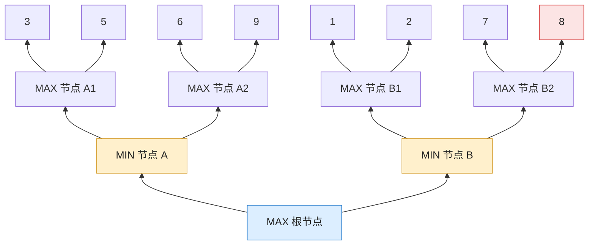
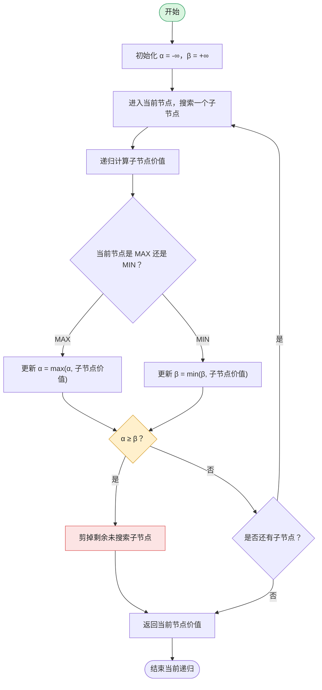

## 1. α、β 参数的本质

重复一遍参数定义：

- $\alpha$ **值**：“或”节点（MAX）当前找到的**下界**（倒推值至少为 $\alpha$）。
  
- $\beta$ **值**：“与”节点（MIN）当前找到的**上界**（倒推值至多为 $\beta$）。

这里进一步理解它们在搜索过程中的作用。

假设根节点 MAX 已经搜索过一个分支，得到价值 5，那么 $\alpha=5$，这意味着 MAX 已经知道，自己至少可以获得 5 分。

接下来搜索另一个 MIN 节点，如果发现其中一个子节点的价值只有 3，那么 $\beta=3$，由于 MIN 会选择最小值，所以这个 MIN 节点最终价值最多为 3。

现在：
$$\alpha=5,\quad\beta=3$$
显然：
$$\alpha\geq\beta$$

这意味着 MAX 已经有一个价值为 5 的方案，而当前分支最多只能得到 3，根本没有必要继续搜索。

**α 和 β 的真正作用，就是记录搜索过程中已经确定的收益边界，利用这些边界判断某个分支是否还有继续搜索的价值。**

## 2. α-β 剪枝的完整示例

下面使用一棵稍微复杂的博弈树，演示剪枝过程。

假设：

- 根节点是 MAX。
  
- 第二层是 MIN。
  
- 第三层是 MAX。
  
- 最底层是终局估价值。

假设从左向右搜索。

### 第一步：搜索左侧 MIN 节点 A。

先搜索 A1：
$$V(A1)=\max(3,5)=5$$
再搜索 A2：
$$V(A2)=\max(6,9)=9$$
所以：
$$V(A)=\min(5,9)=5$$
根节点 MAX 更新：
$$\alpha=5$$
### 第二步：搜索右侧 MIN 节点 B。

先搜索 B1：
$$V(B1)=\max(1,2)=2$$
因此：
$$\beta=2$$
此时：
$$\beta=2\leq\alpha=5$$

### 第三步：执行剪枝。

B2 以及它下面的两个叶子节点 7、8 都不需要继续搜索。

原因是 MIN 节点已经找到一个价值为 2 的选择，最终结果不会高于 2，而根节点已经拥有价值为 5 的选择。所以 B2 不可能影响最终决策。

###  搜索结果

|节点|计算结果|
|---|---|
|A1|5|
|A2|9|
|A|5|
|B1|2|
|B2|剪枝|
|根节点 R|5|

最终选择 A。原本需要评价 8 个叶子节点，现在只需要评价 6 个。

## 2.3 α-β 剪枝算法流程

注意：递归进入子节点时，必须传递当前的 α、β 边界，并在搜索过程中不断更新。不能让每个节点都重新初始化为无穷大。

## 2.4 α-β 剪枝总结

|考点|结论|
|---|---|
|α 的含义|MAX 当前能够保证的下界|
|β 的含义|MIN 当前能够保证的上界|
|初始值|$\alpha=-\infty,\beta=+\infty$|
|剪枝条件|$\alpha\geq\beta$|
|β 剪枝|MAX 节点触发的剪枝|
|α 剪枝|MIN 节点触发的剪枝|
|最终结果|与完整 Minimax 相同|

---

返回原文 [第十一章：博弈树搜索 (Game Tree Search)](第十一章：博弈树搜索%20(Game%20Tree%20Search).md)

