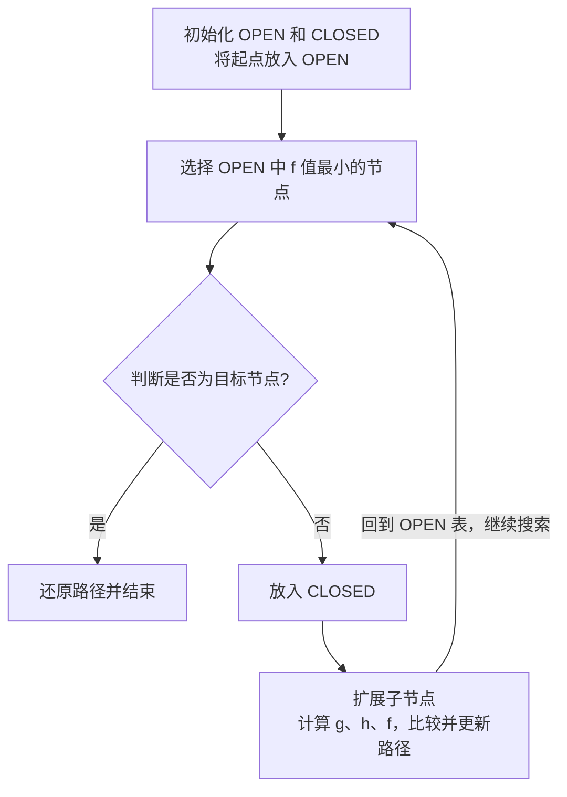

## 首先为什么要研究搜索？

计算机在面对成千上万个可能的路径时，如何判断应该先走哪一条路是个问题。

---

## 为什么需要启发式搜索？

先考虑一个问题：

假设你要从城市 A 前往城市 G，中间有很多城市可以选择。


计算机可以通过搜索算法寻找从 A 到 G 的路径，但是如果可选路径非常多，计算机应该优先探索哪一条？

最简单的思路是：不管方向，按照某种固定顺序逐个搜索，这就是第八章讲过的盲目搜索（[第八章：状态空间法](第八章：状态空间法.md)）的基本思路。

问题在于：

- DFS 可能一直沿着一条很长的错误路径深入。
    
- BFS 可能需要逐层搜索大量节点。
    
- 两者都没有主动利用目的地的信息来判断哪个方向更有希望。

于是就引入了启发式搜索（Heuristic Search），它的思想是：

> 不再单纯按照节点的先后顺序搜索，而是利用已有的信息，估计哪个节点更值得优先探索。

例如，你要从 A 前往 G：

- 路线一：目前已经走了 10 公里，预计还要走 2 公里。
    
- 路线二：目前已经走了 3 公里，预计还要走 15 公里。

虽然路线二目前走得更少，但是路线一显然更有希望更快到达目的地。

这就涉及启发式搜索最重要的两个概念：估价函数和启发式信息。

### 1. 估价函数（Evaluation Function）

$$f(n)=g(n)+h(n)$$
#### （1）$g(n)$：已经付出的实际代价

$g(n)$ 表示：从起点 $S_0$ 到当前节点 $n$，已经实际产生的代价。

例如：

你从 A 出发，经过 B 到达 C：

- A 到 B：5 公里。
    
- B 到 C：3 公里。

那么：$g(C)=5+3=8$。也就是说，你已经走了 8 公里。

#### （2）$h(n)$：未来还需要付出的估计代价

$h(n)$ 表示：从当前节点 $n$ 到目标节点 $G$，预计还需要付出的代价。例如：你现在位于 C，距离终点 G 的实际最短距离是 12 公里。

但是计算机暂时不知道真正的最短距离，只能根据地图直线距离等信息进行估算。假设它估计还需要走 10 公里，这里的 10 公里就是**启发式信息**。

### （3）$f(n)$：估计从起点经过当前节点到达终点的总代价

既然已经知道：

- 已经走了多少：$g(n)$。
    
- 预计还要走多少：$h(n)$。

那么两者相加：$f(n)=g(n)+h(n)$。就得到了从起点经过当前节点到达目标的**总代价估计**。例如：

|当前节点|已走距离 $g(n)$|预计剩余距离 $h(n)$|总估价 $f(n)$|
|---|---|---|---|
|B|5|12|17|
|C|8|10|18|
|D|3|20|23|

计算机应该优先考虑 B，因为 $f(B)=17$ 是三个节点中最小的。

这就是**估价函数的意义：将已经付出的代价和预计未来的代价结合起来，判断当前节点是否值得优先探索**。

### 2. 启发式信息

计算机如何知道 $h(n)$ 应该取多少？

答案是：$h(n)$ 并不是计算机已经知道的真实距离，而是**人为设计或根据问题特征计算出来的估计值**。

例如，在地图导航中：

- 可以使用两个城市之间的直线距离作为估计距离。
    
- 可以使用棋盘上两个位置的曼哈顿距离作为估计距离。
    
- 可以根据问题的特征设计其他估计方法。

这些帮助计算机判断搜索方向的信息，就叫作启发式信息。

因此，启发式搜索并不意味着计算机已经知道正确答案，而是让计算机能够更有方向性地寻找答案。

---

## A 算法与 A* 算法

首先要明确：A 算法和 A\* 算法都使用上述的估价函数 $f(n)=g(n)+h(n)$，但是它们对估价函数有不同的要求。

### 1. A 算法

> 定义：使用 $f(n)=g(n)+h(n)$ 维护一个优先队列（OPEN 表），每次挑选 $f(n)$ 值最小的节点进行扩展。

#### （1）什么是 OPEN 表？

OPEN 表是一个用于存储待扩展节点的集合。

假设计算机已经发现了三个节点：

| 节点  | $f(n)$  |
| --- | ------- |
| A   | 15      |
| B   | 8（优先扩展） |
| C   | 12      |

这些节点已经被发现，但是还没有进行下一步搜索。它们就放在 OPEN 表中。每次选择估价最小的节点，而不是简单地选择最早发现的节点。这里使用的是优先队列（Priority Queue），它与之前学习 BFS 时使用的普通队列不同：

|普通队列 Queue|优先队列 Priority Queue|
|---|---|
|先进先出|按优先级取出|
|谁先进入谁先出来|谁的优先级最高谁先出来|
|BFS 使用|A 算法、A* 算法使用|

在这里，由于 $f(n)$ 代表总代价估计值，因此 $f(n)$ 越小，优先级越高。

#### （2）什么是扩展节点？

扩展节点，就是从当前节点出发，检查它所有可以到达的相邻节点，并将符合条件的新节点加入搜索的过程。

例如：

```
       S
      / \
     A   B
    / \
   C   D
```

假设当前选择 A 进行扩展，计算机就会按照如下流程执行：

1. 取出 A。
    
2. 检查 A 能到达的 C 和 D。
    
3. 分别计算 C、D 的估价。
    
4. 将它们放入 OPEN 表，等待后续搜索。

因此，A 算法并不是简单地计算所有节点的距离，而是不断进行：

```
选择最优先节点 → 扩展节点 → 计算新节点估价 → 更新 OPEN 表
```

### 2. A* 算法

A 算法虽然能够根据估价函数选择更有希望的节点，但它不一定能够保证找到最优解。这是因为 $h(n)$ 是估计值。如果估计值不合理，计算机就可能被错误的信息误导。例如：

从当前位置到终点实际最短距离是 10 公里，然而启发函数却估计为 30 公里。这就是**高估**。如果算法过度依赖这样的估价，就可能错误地判断搜索方向。为了解决这个问题，引入了 A* 算法。

**A\* 算法的关键是：对启发函数施加限制，使其不能高估到达目标所需的最小实际代价**。这就是可纳性条件（Admissibility）。
#### （1）可纳性条件

$$h(n)\leq h^*(n)$$

其中：

- $h(n)$：计算机估计的剩余代价。
    
- $h^*(n)$：从当前节点到目标节点的真实最短代价。

这意味着：$\text{估计代价}\leq\text{实际代价}$

举个例子，假设当前位置距离终点的实际最短距离是 20 公里。那么：

|估计距离 $h(n)$|是否满足可纳性条件|
|---|---|
|5 公里|满足|
|10 公里|满足|
|18 公里|满足|
|20 公里|满足|
|25 公里|不满足|
|30 公里|不满足|

**只要估计值不超过真实最短距离，就满足可纳性条件**。

注意：可纳性条件并不要求估计值必须非常准确，也不要求必须等于实际距离。它**只要求不能高估**。

#### （2）为什么不能高估就能保证最优解？

第一，$g(n)$ 是已经发生的实际代价，不存在估计误差。

第二，$h(n)$ 不会高估未来的最短代价。

因此 $f(n)=g(n)+h(n)$ 就不会超过从起点经过节点 $n$ 再到达目标的最优路径代价。换句话说，$f(n)$ 可以看作一条候选路径的乐观估计。A* 算法每次选择 $f(n)$ 最小的节点进行扩展。如果某个目标节点已经被取出，而仍然存在一条更短的路径，那么这条更短路径上必然存在一个尚未扩展的节点，其估价应该小于当前目标节点的实际总代价。这与当前目标节点是 OPEN 表中估价最小的节点相矛盾。所以，在标准的 A* 搜索条件下，当目标节点从 OPEN 表中取出时，就可以保证找到最优解。

这里的标准条件还包括边代价非负，并且对于图搜索，要正确处理已经进入 CLOSED 表的节点：如果发现更短路径，需要重新打开该节点，或者使用满足一致性条件的启发函数来避免这个问题。

上述一言以蔽之即：**找到目标节点时不一定是最优解；只有目标节点成为 OPEN 表中估值最小的节点并被取出时，才能保证找到最优解**。

所以，**A 与普通 A\* 算法最重要的区别就是：A\* 使用满足可纳性条件的启发函数，从而获得最优解保证。**

---

## A* 算法的核心性质与算法流程

A\*算法引入了两个表：

- OPEN 表：存放已经发现、但尚未扩展的节点。
    
- CLOSED 表：存放已经扩展过的节点。

### 构造一个具体的搜索案例

为了方便逐步计算，我们定义如下图结构：

%22%20viewBox%3D%220%200%20340%20220%22%20width%3D%22100%25%22%20xmlns%3D%22http%3A%2F%2Fwww.w3.org%2F2000%2Fsvg%22%3E%3Cg%20stroke%3D%22currentColor%22%20stroke-width%3D%221.6%22%20opacity%3D%220.7%22%20fill%3D%22none%22%3E%3Cpath%20d%3D%22M35%20110%20L110%2045%20L205%2045%20L305%20110%22%2F%3E%3Cpath%20d%3D%22M35%20110%20L110%20175%20L205%20175%20L305%20110%22%2F%3E%3Cpath%20d%3D%22M110%2045%20L205%20175%22%2F%3E%3Cpath%20d%3D%22M110%20175%20L205%2045%22%2F%3E%3C%2Fg%3E%3Ccircle%20cx%3D%2235%22%20cy%3D%22110%22%20r%3D%2217%22%20fill%3D%22%232563eb%22%2F%3E%3Ctext%20x%3D%2235%22%20y%3D%22115%22%20fill%3D%22white%22%20font-size%3D%2213%22%20font-weight%3D%22bold%22%20text-anchor%3D%22middle%22%3ES%3C%2Ftext%3E%3Ccircle%20cx%3D%22110%22%20cy%3D%2245%22%20r%3D%2217%22%20fill%3D%22%232563eb%22%2F%3E%3Ctext%20x%3D%22110%22%20y%3D%2250%22%20fill%3D%22white%22%20font-size%3D%2213%22%20font-weight%3D%22bold%22%20text-anchor%3D%22middle%22%3EA%3C%2Ftext%3E%3Ccircle%20cx%3D%22110%22%20cy%3D%22175%22%20r%3D%2217%22%20fill%3D%22%232563eb%22%2F%3E%3Ctext%20x%3D%22110%22%20y%3D%22180%22%20fill%3D%22white%22%20font-size%3D%2213%22%20font-weight%3D%22bold%22%20text-anchor%3D%22middle%22%3EB%3C%2Ftext%3E%3Ccircle%20cx%3D%22205%22%20cy%3D%2245%22%20r%3D%2217%22%20fill%3D%22%232563eb%22%2F%3E%3Ctext%20x%3D%22205%22%20y%3D%2250%22%20fill%3D%22white%22%20font-size%3D%2213%22%20font-weight%3D%22bold%22%20text-anchor%3D%22middle%22%3EC%3C%2Ftext%3E%3Ccircle%20cx%3D%22205%22%20cy%3D%22175%22%20r%3D%2217%22%20fill%3D%22%232563eb%22%2F%3E%3Ctext%20x%3D%22205%22%20y%3D%22180%22%20fill%3D%22white%22%20font-size%3D%2213%22%20font-weight%3D%22bold%22%20text-anchor%3D%22middle%22%3ED%3C%2Ftext%3E%3Ccircle%20cx%3D%22305%22%20cy%3D%22110%22%20r%3D%2217%22%20fill%3D%22%232563eb%22%2F%3E%3Ctext%20x%3D%22305%22%20y%3D%22115%22%20fill%3D%22white%22%20font-size%3D%2213%22%20font-weight%3D%22bold%22%20text-anchor%3D%22middle%22%3EG%3C%2Ftext%3E%3Cg%20fill%3D%22currentColor%22%20font-size%3D%2211%22%20text-anchor%3D%22middle%22%3E%3Ctext%20x%3D%2265%22%20y%3D%2268%22%3E2%3C%2Ftext%3E%3Ctext%20x%3D%2265%22%20y%3D%22160%22%3E5%3C%2Ftext%3E%3Ctext%20x%3D%22157%22%20y%3D%2231%22%3E2%3C%2Ftext%3E%3Ctext%20x%3D%22157%22%20y%3D%22201%22%3E2%3C%2Ftext%3E%3Ctext%20x%3D%22166%22%20y%3D%22116%22%3E3%3C%2Ftext%3E%3Ctext%20x%3D%22143%22%20y%3D%22117%22%3E4%3C%2Ftext%3E%3Ctext%20x%3D%22258%22%20y%3D%2268%22%3E7%3C%2Ftext%3E%3Ctext%20x%3D%22258%22%20y%3D%22160%22%3E2%3C%2Ftext%3E%3C%2Fg%3E%3C%2Fsvg%3E)

我们明确规定以下边及其代价：

|起点|终点|移动代价|
|---|---|---|
|S|A|2|
|S|B|5|
|A|C|2|
|A|D|4|
|B|C|3|
|B|D|2|
|C|G|7|
|D|G|2|

再给每个节点一个启发式估计值 $h(n)$：

|节点|$h(n)$|
|---|---|
|S|6|
|A|5|
|B|4|
|C|6|
|D|2|
|G|0|

这里的 $h(n)$ 是算法对剩余距离的估计，不是已经实际走过的距离。

**注意：目标节点 G 的启发式值为 0，因为到达目标后不再需要移动**。

### 正式执行 A* 算法

除了OPEN表和CLOSED表我们还需要为每个节点记录：

- $g(n)$：从 S 到该节点的当前最短已知代价。
    
- $h(n)$：启发式估计值。
    
- $f(n)$：两者之和。
    
- Parent：该节点目前是从哪个节点到达的，用于最后还原路径。

下面开始执行。

#### 第 0 步：初始化

初始状态：
- 起点：S
- 目标：G
- OPEN 中只有 S。
- CLOSED 为空。

计算起点：
- g(S)=0
- f(S)=g(S)+h(S)=0+6=6

此时，OPEN 表如下：

|节点|g|h|f|
|---|---|---|---|
|S|0|6|6|

CLOSED 表如下：

空

#### 第 1 步：取出 S，扩展其子节点

从 OPEN 中选择 $f(n)$ 最小的节点。

目前只有 S，因此选择 S。S 不是目标节点 G，于是：
1. 将 S 从 OPEN 移除。
2. 将 S 放入 CLOSED。
3. 扩展 S，寻找它的所有相邻节点。
S 有两个子节点：A、B。

计算 A：
- g(A)=g(S)+c(S,A)=0+2=2
- f(A)=g(A)+h(A)=2+5=7

计算 B：
- g(B)=g(S)+c(S,B)=0+5=5
- f(B)=g(B)+h(B)=5+4=9

因此，A 和 B 都进入 OPEN。

此时，OPEN 表如下：

|节点|g|h|f|
|---|---|---|---|
|A|2|5|7|
|B|5|4|9|

CLOSED 表如下：

S

现在比较 A 和 B：由于 $f(A)=7 < f(B)=9$。所以，下一步优先扩展 A。

#### 第 2 步：取出 A，扩展其子节点

将 A 从 OPEN 中取出，放入 CLOSED。接下来扩展 A。A 有两个子节点：C、D。
计算 C：
- g(C)=g(A)+c(A,C)=2+2=4
- f(C)=4+6=10
计算 D：
- g(D)=g(A)+c(A,D)=2+4=6
- f(D)=6+2=8

于是 C、D 进入 OPEN。

此时，OPEN 表如下：

|节点|g|h|f|
|---|---|---|---|
|D|6|2|8|
|B|5|4|9|
|C|4|6|10|

CLOSED 表如下：

S → A

现在：$f(D)=8 < f(B)=9 < f(C)=10$，因此，下一步选择 D。

这里可以观察到一个重要现象：虽然 C 的实际代价只有 4，比 D 的 6 更低，但是 D 的启发式估计值更低，因此 D 的综合评价值更低。

这就是前面强调过的：**A\* 不一定优先扩展目前实际代价最小的节点，而是优先扩展 f 值最小的节点。**

#### 第 3 步：取出 D，扩展其子节点

将 D 从 OPEN 取出，放入 CLOSED。D 有一个子节点：G。

计算：
- g(G)=g(D)+c(D,G)=6+2=8
- f(G)=g(G)+h(G)=8+0=8

G 进入 OPEN。

此时，OPEN 表如下：

|节点|g|h|f|
|---|---|---|---|
|G|8|0|8|
|B|5|4|9|
|C|4|6|10|

CLOSED 表如下：

S → A → D

现在 OPEN 中的最小值是：$f(G)=8$，取出 G。G 是目标节点，因此搜索成功，算法终止。

### 还原最终路径

现在已经找到目标节点 G，但算法还需要知道从 S 到 G 究竟经过了哪些节点，这就是 Parent（父节点记录）的作用。我们在扩展过程中记录来了如下内容：

|节点|Parent|
|---|---|
|S|无|
|A|S|
|B|S|
|C|A|
|D|A|
|G|D|

从目标节点 G 开始，沿着 Parent 反向追溯：$G \leftarrow D \leftarrow A \leftarrow S$，反转后得到最终（最优）路径：$S \rightarrow A \rightarrow D \rightarrow G$。

路径总成本为 $2+4+2=\boxed{8}$。我们把刚才的实际搜索过程整理成一张表：

|轮次|选择扩展|新发现节点|OPEN 中最小 f|
|---|---|---|---|
|0|—|S|6|
|1|S|A、B|7（A）|
|2|A|C、D|8（D）|
|3|D|G|8（G）|
|4|G|目标，结束|—|

整个过程可以概括为：



### A* 算法的核心性质

1. 完备性（Completeness）

在有限分支、每步代价有正下界等适当条件下，只要存在解，A* 就能够找到解。

2. 最优性（Optimality）

当启发式函数满足可采纳性（Admissibility），即：$h(n)\leq h^*(n)$，那么树搜索版本的 A 可以保证找到最优解。

3. 搜索效率

A* 通过 $h(n)$ 引导搜索方向，通常比不考虑目标方向的盲目搜索更有效率。

不过，启发式函数越准确，通常搜索效率越高；如果 $h(n)=0$，A* 就退化为均匀代价搜索（Dijkstra 算法）。