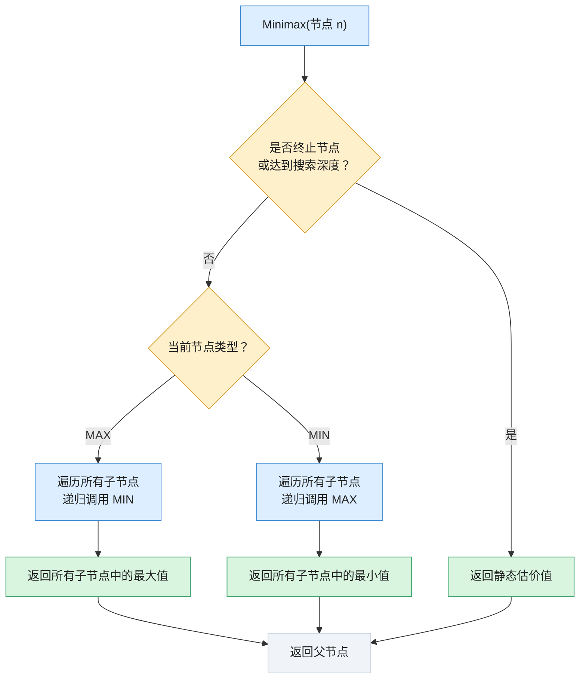

## 1. 基本思想

首先回顾博弈树：

- MAX 节点：轮到己方行动，选择收益最大的分支。
    
- MIN 节点：轮到对方行动，选择对己方收益最小的分支。

Minimax 的**核心思想是：假设双方都是理性的，都会选择对自己最有利的行动，因此己方决策时必须考虑对手可能采取的最佳反击。**

举个简单的例子：假设你正在下棋，现在轮到你（MAX）行动，你有两个选择 A 和 B。 
- 选择 A 后，对手可以采取两种应对，最终收益分别为 3 和 5。
- 选择 B 后，对手可以采取两种应对，最终收益分别为 2 和 9。

你不能直接选择收益最大的 9，因为对手不会故意让你获得 9 分。对手会选择让你收益最低的方案。因此：
- 选择 A：对手选择 3，你最终收益为 3。
- 选择 B：对手选择 2，你最终收益为 2。

最终你应该选择 A。这就是 **Minimax 的基本逻辑：对手取最小值，己方取最大值。**

## 2. 两种核心估值

Minimax 算法需要为博弈树中的节点计算价值，主要涉及两个概念。

### 2.1 静态估价值与倒推值
#### （1）静态估价值（Static Evaluation Value）

静态估价值是通过估价函数，对当前博弈局面进行评价，得到一个数值。

例如，以 A 方为己方：

|估价值|局面含义|
|---|---|
|+100|A 方具有明显优势|
|+50|A 方具有一定优势|
|0|双方局势均衡|
|-50|B 方具有一定优势|
|-100|B 方具有明显优势|

数值越大，说明局面对 A 方越有利；数值越小，说明局面对 B 方越有利。

这里需要区分两种情况：

- 如果搜索到游戏结束，直接使用实际胜负结果计算价值，这叫终局评价。
- 如果搜索到一定深度就停止，但游戏还没有结束，则通过启发式估价函数评价当前局面，这才是通常所说的静态估值。例如，国际象棋不可能每次都搜索到游戏结束，因此通常需要对当前棋盘局势进行估价。

#### （2）倒推值（Backpropagation Value）

倒推值是指将叶子节点的估价值，从博弈树底部逐层向上传递，计算父节点的价值。计算规则如下：

- **MAX 节点**：取所有子节点中的最大值。

$$V(n) = \max_{j \in Succ(n)} V(j)$$

- **MIN 节点**：取所有子节点中的最小值。

$$V(n) = \min_{j \in Succ(n)} V(j)$$
其中 $Succ(n)$ 表示节点 $n$ 的所有子节点集合，$V(j)$ 表示子节点的倒推值或静态估价值。通过这种自底向上的递归回溯，整棵博弈树的根节点最终会得到一个最优决策估价值。

### 2.2 Minimax 的算法实现逻辑

前面我们已经知道，Minimax 需要从叶子节点开始向上计算价值。实际编程时，通常使用 **递归（Recursion）** 实现。

其核心逻辑如下：

```
Minimax(当前节点, 搜索深度, 是否MAX节点):

    如果当前节点是终止节点，或者达到搜索深度:
        返回当前节点的估价值

    如果当前是MAX节点:
        初始化 best = -∞
        遍历所有子节点:
            value = Minimax(子节点, 深度-1, MIN)
            best = max(best, value)
        返回 best

    如果当前是MIN节点:
        初始化 best = +∞
        遍历所有子节点:
            value = Minimax(子节点, 深度-1, MAX)
            best = min(best, value)
        返回 best
```

这里有三个值得注意的地方：

1. 递归终止条件： 到达游戏结束状态，或者达到预设搜索深度。
2. 递归调用： 每次向下一层搜索，都将 MAX 和 MIN 身份进行切换。
3. 返回价值： 每一层根据自己的节点类型，选择最大值或最小值返回上一层。

可以将整个递归过程理解为：



这也是 Minimax 算法能够处理不同深度博弈树的原因：无论博弈树有多少层，都可以通过递归逐层计算。

## 1.7 九宫棋（Tic-Tac-Toe）估价函数

估价函数是：$h(n)=win(A)-win(B)$，其中，`win(A)` 和 `win(B)` 分别表示双方仍然具有获胜可能的连线数量。

九宫棋一共有 8 条可能的获胜连线。

- 如果某条线上已经出现 B 的棋子，那么 A 就不可能通过这条线获胜。
    
- 如果某条线上只有 A 的棋子和空格，那么这条线仍然是 A 的潜在获胜路线。
    
- B 的判断方法完全相同。

因此，估价函数通过统计双方剩余的潜在获胜路线，判断当前局面对谁更有利。

需要注意：这是一个简单的启发式估价函数，并不是唯一设计方法。实际应用还可以考虑两连子威胁、中心位置控制、必胜局面等因素。

---

返回原文 [第十一章：博弈树搜索 (Game Tree Search)](第十一章：博弈树搜索%20(Game%20Tree%20Search).md)