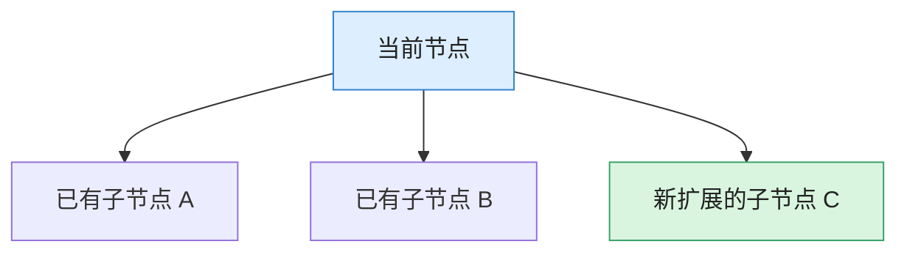
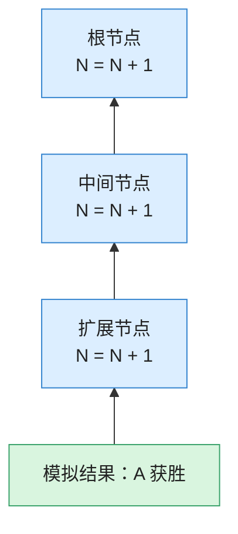
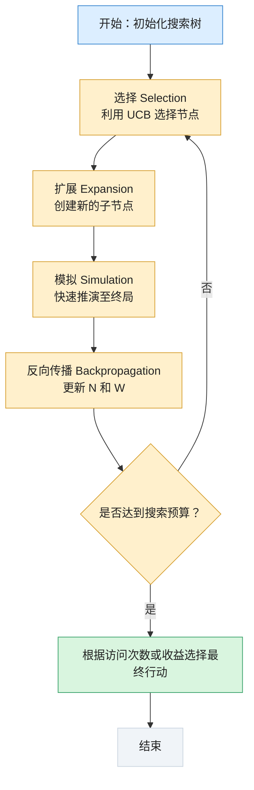

## 1. MCTS 的核心思想

Minimax 需要通过搜索和估价来推断未来局面，而 MCTS 采用了另一种思路：**通过反复模拟游戏，统计每个行动在大量模拟中的表现，从而估计它的价值。**

例如，假设现在有三个可选行动：

- 行动 A：模拟 100 次，胜利 70 次。
    
- 行动 B：模拟 100 次，胜利 50 次。
    
- 行动 C：模拟 100 次，胜利 30 次。

那么对应的模拟胜率分别为：

|行动|胜利次数|访问次数|胜率|
|---|---|---|---|
|A|70|100|70%|
|B|50|100|50%|
|C|30|100|30%|

从目前的模拟结果看，行动 A 最有希望。但是，MCTS 不会始终选择目前胜率最高的行动，因为一些尚未充分探索的行动可能隐藏着更好的结果。因此还需要 UCB 机制。

## 2. MCTS 四步循环详解

### 第一步：选择（Selection）

从根节点开始，沿着已有的博弈树向下选择节点。选择时利用 UCB 公式，综合考虑**当前节点的历史胜率、当前节点的访问次数、父节点的访问次数**，目标是在已有的优秀分支和较少探索的分支之间取得平衡。

### 第二步：扩展（Expansion）

当选择到一个尚有未探索行动的节点时，选择其中一个未探索行动，创建新的子节点。例如：

**扩展的目的就是逐步增加搜索树的规模，而不是一开始就生成完整博弈树。**

### 第三步：模拟（Simulation）

从新扩展的节点出发，继续进行快速走子，直到游戏结束。例如：

- A 获胜：记录一次胜利。
    
- B 获胜：记录一次失败。
    
- 平局：根据具体实现记录为 0.5 或其他约定收益。

这里的模拟通常使用随机策略或轻量级策略，不要求每一步都采用严格的最优行动。

### 第四步：反向传播（Backpropagation）

模拟结束后，将结果沿着刚才经过的路径逐层向上传递。主要更新两个统计量：

- $N$：节点被访问的次数。
    
- $W$：节点累计获得的收益或胜利次数。

例如，模拟结果为 A 获胜，那么沿搜索路径上的相关节点都会更新访问次数和收益统计。

注意：在双方轮流行动的博弈中，实际**必须统一收益统计视角**。例如，可以始终统计 MAX 的收益，也可以按当前行动方视角切换胜负统计。不能不加区分地把同一方的胜利记为所有层级节点的胜利。

## 3. 如何理解UCB 公式

公式：
$$UCB_j = \overline{X_j} + C \sqrt{\frac{\ln N}{n_j}}$$

我们分别理解两个部分：

- **第一部分：利用（Exploitation）**
	$$\overline{X_j} = \frac{W_j}{n_j}$$
	表示当前节点的平均收益，通常可以用胜率表示（其中 $W_j$ 是该节点累计获得的收益）。例如，访问 100 次，获胜 70 次，$\overline{X_j} = \frac{70}{100} = 0.7$。该值越高，说明这个节点过去的模拟表现越好。
	
- **第二部分：探索（Exploration）**
	$$C \sqrt{\frac{\ln N}{n_j}}$$
    
    其中 $N$ 是父节点访问总次数（$N$ 越大，探索其他分支需求越高），$n_j$ 是当前节点访问次数（$n_j$ 越小，探索价值越高），$C$ 决定探索倾向的强弱。
    
    - $C$ 较大：更重视探索，愿意尝试访问次数少的节点。
        
    - $C$ 较小：更重视利用，倾向于选择历史表现优秀的节点。
        

|**UCB 组成部分**|**核心含义**|**目的**|
|---|---|---|
|**利用 (Exploitation)**|历史表现 ($\overline{X_j}$)|选择过去模拟胜率较高的节点|
|**探索 (Exploration)**|访问次数少 ($n_j$)|避免过早放弃尚未充分尝试的节点|

## MCTS 完整算法流程图

MCTS 最后选择哪个行动，不一定直接选择 UCB 值最大的节点。UCB 主要用于搜索过程中的节点选择，最终行动通常根据子节点的访问次数、胜率等统计指标确定。

---

返回原文 [第十一章：博弈树搜索 (Game Tree Search)](第十一章：博弈树搜索%20(Game%20Tree%20Search).md)