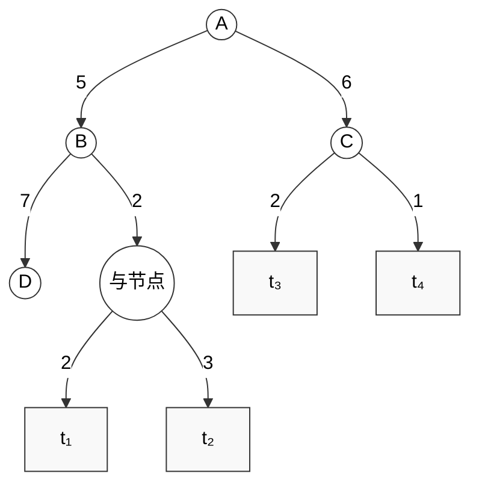

以下图为例：

## 一、 和代价法（Sum Cost Method）

在和代价法中：

- 终叶节点（本原问题）的代价记为 $0$。
    
- **与节点 (AND)** 的代价为其所有子节点（连线弧代价 + 子节点代价）的**总和 ($\sum$)**。
    
- **或节点 / 选择分支**取各可选路径的**最小值 ($\min$)**。
    
- 根节点 $A$ 的两个主分支（$B$ 和 $C$）采取累加求和。

### 计算步骤：

1. **底部的中间与节点**：
    
    - 连接 $t_1$（弧代价 2）和 $t_2$（弧代价 3）。
        
    - $\text{Cost}(\text{与节点}) = (2 + 0) + (3 + 0) = 5$
        
2. **节点 B**（有两个可选分支，取 $\min$）：
    
    - 分支一（通往 $D$）：$7 + 0 = 7$
        
    - 分支二（通往中间与节点）：$2 + 5 = 7$
        
    - $\text{Cost}(B) = \min(7, 7) = 7$
        
    - 通过 $B$ 的总代价 = 连线弧代价 $5 + \text{Cost}(B) = 5 + 7 = 12$。
        
3. **节点 C**（连接 $t_3$ 和 $t_4$，属于与节点关系）：
    
    - $\text{Cost}(C) = (2 + 0) + (1 + 0) = 3$
        
    - 通过 $C$ 的总代价 = 连线弧代价 $6 + \text{Cost}(C) = 6 + 3 = 9$。
        
4. **根节点 A**（将左右两部分求和）：
    
    - $\text{Total Cost} = 12 + 9 = \mathbf{21}$
        

## 二、 最大代价法（Max Cost Method）

在最大代价法中：

- **终叶节点**的代价为 $0$。
    
- **与节点 (AND)** 的代价为其所有子节点（连线弧代价 + 子节点代价）中的**最大值 ($\max$)**。
    
- **或节点 / 选择分支**仍取各可选路径的**最小值 ($\min$)**。
    
- 根节点 $A$ 处取左右两支的**最大值 ($\max$)**。

### 计算步骤：

1. **底部的中间与节点**：
    
    - $\text{Cost}(\text{与节点}) = \max(2 + 0, 3 + 0) = 3$
        
2. **节点 B**：
    
    - 分支一（通往 $D$）：$7 + 0 = 7$
        
    - 分支二（通往中间与节点）：$2 + 3 = 5$
        
    - $\text{Cost}(B) = \min(7, 5) = 5$
        
    - 通过 $B$ 的总代价 = 连线弧代价 $5 + \text{Cost}(B) = 5 + 5 = 10$。
        
3. **节点 C**（与节点）：
    
    - $\text{Cost}(C) = \max(2 + 0, 1 + 0) = 2$
        
    - 通过 $C$ 的总代价 = 连线弧代价 $6 + \text{Cost}(C) = 6 + 2 = 8$。
        
4. **根节点 A**（取左右分支的最大值）：
    
    - $\text{Total Cost} = \max(10, 8) = \mathbf{10}$