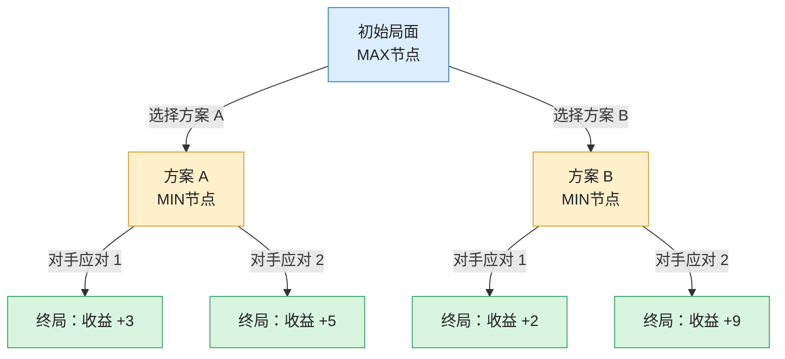
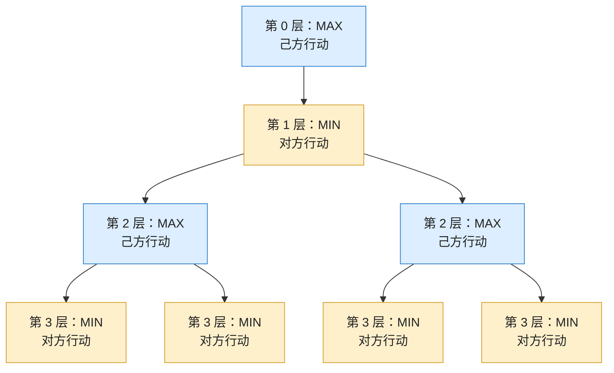

## 1. 核心概念与基础

### 1.1 博弈的基本特征

本章讨论的博弈属于 **二人零和、全信息、非偶然** 的棋类博弈（即，这一部分主要研究：在**双方轮流行动、互相竞争的游戏中，如何通过搜索博弈树，选择对自己最有利的行动**。这一过程中双方的目标完全相反，A 希望自己的收益最大化，B 则希望 A 的收益最小化）：

- **二人零和 (Two-player Zero-sum)**：双方对立，一方的收益等于另一方的损失，双方的利益之和为零（A胜、A负、平局）。
    
- **全信息 (Perfect Information)**：双方对当前及历史的所有格局（当前局面以及之前发生的所有行动）完全了解。
    
- **非偶然 (No Chance/Deterministic)**：不存在掷骰子或抽牌等“碰运气”的随机因素，当前局面和双方采取的行动共同决定下一局面。

上一章学习的与或图搜索（AO*）主要解决复杂问题的分解与求解，而博弈树搜索进一步考虑了一个重要因素：**对手也会主动选择对自己最有利的行动**。因此，我们不能只考虑自己下一步怎么走，还必须考虑对手接下来可能采取什么行动。

### 1.2 什么是博弈树？

博弈树是一种特殊的“与/或”树，用于描述游戏过程中双方可能采取的行动及其产生的后续局面。

- **节点与关系**：站在**己方 (A方/MAX)** 的视角：
    
    - **或节点 (OR / MAX 节点)**：轮到己方行动，己方可以从多个可选行动中**选择一个最有利的行动**，目标是让自己的收益最大化。
        
    - **与节点 (AND / MIN 节点)**：轮到对方行动，对方会选择对己方最不利的行动，因此需要**考虑对方可能采取的所有应对方案**。
	    
- **交替出现**：“或”节点与“与”节点在博弈树中逐层交替出现。

#### 一个简化的博弈树示意图

图中：
- 蓝色节点：MAX 节点，轮到 A 行动。
- 黄色节点：MIN 节点，轮到 B 行动。
- 绿色节点：终止节点，表示游戏结束，对应不同的收益。

那么，A 应该选择方案 A 还是方案 B？由于 B 是理性对手，会尽可能降低 A 的收益：
- 选择方案 A：B 会选择收益较低的结果，即 $\min(3,5)=3$。
- 选择方案 B：B 会选择收益较低的结果，即 $\min(2,9)=2$。

因此，A 最终选择：$\max(3,2)=3$，也就是选择方案 A。这个过程就是后续要学习的 极大极小算法（Minimax Algorithm） 的基本思想。

#### MAX 节点 与 MIN 节点的交替出现

在典型的双方轮流行动的博弈中，MAX 和 MIN 节点通常逐层交替出现：

其基本规律是：

|层次|节点类型|行动方|决策目标|
|---|---|---|---|
|第 0 层|MAX|己方|最大化收益|
|第 1 层|MIN|对方|最小化己方收益|
|第 2 层|MAX|己方|最大化收益|
|第 3 层|MIN|对方|最小化己方收益|

这种交替关系体现了博弈双方轮流行动、相互对抗的特点。对于存在连续行动权等特殊规则的游戏，层次不一定严格按照 MAX、MIN 交替。

## 2. 极大极小分析法 (Minimax Algorithm)

这一算法解决如下问题：如何考虑对手的最佳应对，从而选择对自己最有利的行动？
### 2.1 基本原理

- **静态估价值 (Static Evaluation Value)**：利用启发式估价函数 $f(n)$ 计算博弈树最底层（端节点）的得分。得分越高越有利于己方，得分越低越有利于对方。
    
- **倒推值 (Backpropagation Value)**：自底向上推算父节点的得分：
    
    - **或节点 (MAX 节点)**：选择子节点分数的 **最大值**（己方追求利益最大化）。
        
    - **与节点 (MIN 节点)**：选择子节点分数的 **最小值**（假设对方极其聪明，会选择使己方收益最小的步数）。
		

没看懂？更详细解释见 [如何理解极大极小分析法（Minimax Algorithm）](概念分述/如何理解极大极小分析法（Minimax%20Algorithm）.md)

### 2.2 典型实例：九宫棋 (Tic-Tac-Toe)

- **估价函数设计**：设 $h(n) = \text{win}(A) - \text{win}(B)$  
    
    - $\text{win}(A)$：A方（己方）所有可能的“赢线”（空线或只有A棋子的线）。
        
    - $\text{win}(B)$：B方（对方）所有可能的“赢线”。
        
    - 特殊终局：A胜取 $+\infty$，B胜取 $-\infty$，平局取 $0$。
        

## 3. $\alpha-\beta$ 剪枝技术 ($\alpha-\beta$ Pruning)

该算法解决如下问题：如何减少不必要的节点搜索，提高 Minimax 的搜索效率？为了提高搜索效率，避免遍历所有节点，可以使用剪枝算法裁掉“对决策没有影响”的分支。
### 3.1 参数定义

- $\alpha$ **值**：“或”节点（MAX）当前找到的**下界**（倒推值至少为 $\alpha$）。
    
- $\beta$ **值**：“与”节点（MIN）当前找到的**上界**（倒推值至多为 $\beta$）。

### 3.2 剪枝规则

1. $\beta$ **剪枝**：当某个“或”节点的 $\alpha$ 值大于等于其父“与”节点的 $\beta$ 值（即 $\alpha \ge \beta$）时，停止搜索该“或”节点的其他子节点。
    
2. $\alpha$ **剪枝**：当某个“与”节点的 $\beta$ 值小于等于其父“或”节点的 $\alpha$ 值（即 $\beta \le \alpha$）时，停止搜索该“与”节点的其他子节点。

没看懂？更详细解释见 [如何理解 alpha-beta 剪枝技术(alpha-beta Pruning)](概念分述/如何理解%20alpha-beta%20剪枝技术(alpha-beta%20Pruning).md)

## 4. 蒙特卡洛树搜索 (MCTS)

该算法解决如下问题：当博弈树规模过大，无法穷举时，如何利用随机模拟寻找较好的行动？
### 4.1 MCTS 四步循环

1. **选择 (Selection)**：从根节点开始，利用 **UCB 策略** 选出最有价值的节点往下走。
    
2. **扩展 (Expansion)**：在选中的节点下创建一个新的子节点。
    
3. **模拟/推演 (Simulation)**：从新节点出发，采用快速走子策略（如随机下棋）推演至游戏结束，得到胜负结果。
    
4. **反向传播 (Backpropagation)**：将模拟结果沿路径更新回根节点（增加访问次数 $N$ 与胜利次数 $V$）。

### 4.2 UCB 公式 (Upper Confidence Bound)

在选择阶段，使用 UCB 公式平衡 **利用 (Exploitation)** 与 **探索 (Exploration)**：

$$UCB = \overline{X_j} + C \times \sqrt{\frac{\ln N}{n_j}}$$

- $\overline{X_j}$：节点的估算胜率（胜场 / 访问次数 $n_j$）。
    
- $n_j$：当前节点被访问的次数。
    
- $N$：父节点被访问的总次数。
    
- $C$：平衡因子（$C$ 越大越倾向于去**探索**未被充分尝试的偏门节点；$C$ 越小越倾向于**利用**当前胜率高的高频节点）。

没看懂？更详细解释见 [如何理解蒙特卡洛树搜索（MCTS）](概念分述/如何理解蒙特卡洛树搜索（MCTS）.md)

---
## 总结

| **算法**      | **核心机制** | **需要掌握的内容 如何理解极大极小分析法（Minimax Algorithm）.md** |
| ----------- | -------- | --------------------------------------------- |
| **Minimax** | 极大极小倒推   | MAX 最大、MIN 最小、递归搜索                            |
| **α-β 剪枝**  | 利用收益边界剪枝 | α、β 定义及 $\alpha \geq \beta$                   |
| **MCTS**    | 随机模拟统计   | 四步循环、UCB 公式                                   |

---

上一章：【[第十章：与或图搜索](第十章：与或图搜索.md)】

下一章：【[第十二章：遗传算法 (Genetic Algorithm, GA)](第十二章：遗传算法%20(Genetic%20Algorithm,%20GA).md)】