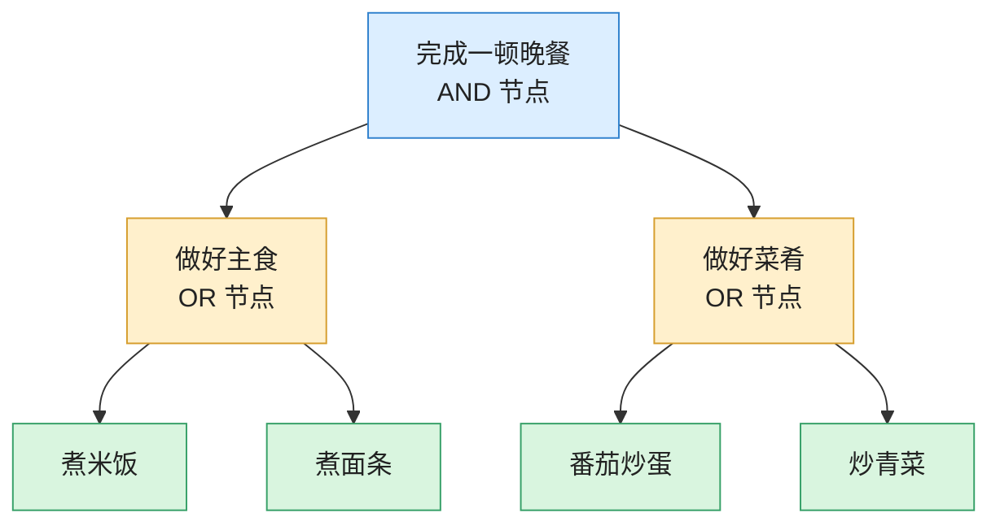
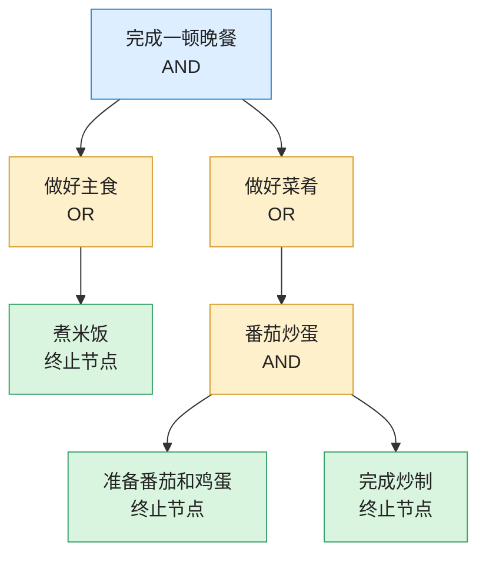
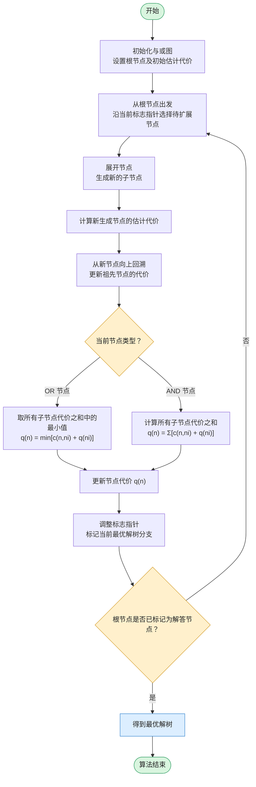

## 1. 与或图基本概念 (AND/OR Graph)

许多复杂问题可以通过**问题分解 (Problem Reduction)** 转化为较小的子问题：

- **“或”节点 (OR Node)**：解决该节点的问题，只需解决其子节点中的**任意一个**。
    
- **“与”节点 (AND Node)**：解决该节点的问题，必须解决其**所有子节点**。

与或图表达了问题的分解关系，其目标不再是一条简单的**路径**，而是一棵**解树 (Solution Tree)**。

### 与或图的示例

假设现在有一个目标：完成一顿晚餐。那么我们可以将它分解为以下子问题：

1. 做好主食：可以选择煮米饭，也可以选择煮面条。
    
2. 做好菜肴：可以选择番茄炒蛋，也可以选择炒青菜。

其中：

- 完成晚餐，需要同时做好主食和菜肴，因此是 AND 节点。
    
- 做好主食，只需要选择米饭或面条中的一种，因此是 OR 节点。
    
- 做好菜肴，只需要选择番茄炒蛋或炒青菜中的一种，因此也是 OR 节点。

因此我们的与或图可以绘制如下：

## 2. 解树 (Solution Tree)

- **解树的定义**：
    
    1. 包含初始节点（根节点）。
        
    2. 对于解树中的每一个“或”节点，**恰好包含其一个**子节点。
        
    3. 对于解树中的每一个“与”节点，**包含其所有的**子节点。
        
    4. 解树的所有叶子节点都必须是**终止/目标节点**。
        

### 解树的示例

接续上一条与或图的示例，假设我们决定：
- 主食选择煮米饭;
- 菜肴选择番茄炒蛋；

那么，原来的与或图就可以按照这个选择，生成一棵具体的解树：

## 3.与或图和解树的区别

| 对比项    | 与或图（AND/OR Graph） | 解树（Solution Tree）    |
| ------ | ----------------- | -------------------- |
| 本质     | 问题分解关系的表示         | 具体解决方案的表示            |
| 节点     | AND 节点、OR 节点      | AND 节点、OR 节点、终止/目标节点 |
| 分支     | 展示所有可能的分解方式       | 展示实际采用的分解方式          |
| OR 节点  | 可以有多个候选子节点        | 只选择一个子节点             |
| AND 节点 | 必须包含所有子节点         | 必须包含所有子节点            |
| 目的     | 描述问题如何分解          | 找到一套完整的解决方案          |

## 4. AO* 算法 (AO* Algorithm)

AO* 算法是**专门用于在与或图中寻找最优解树**的**启发式搜索算法**。与 A* 算法不同，AO* 采用**图的自顶向下扩展**与**评价函数的自底向上更新**相结合的机制，即核心是一个循环过程：自顶向下展开节点 → 自底向上更新代价 → 选择新的最优分支 → 判断是否找到完整解。
### 核心步骤：

1. **图扩展阶段（自顶向下）**：
    
    - 从根节点出发，根据当前的估计代价，选择当前最有希望的解树部分进行扩展，生成新的子节点。
        
2. **代价更新阶段（自底向上）**：
    
    - 从新生成的节点回溯回根节点，重新计算并更新各节点的代价值 $q(n)$：
        
        - 若 $n$ 为“或”节点：$q(n) = \min_{i} \{ c(n, n_i) + q(n_i) \}$  
            
        - 若 $n$ 为“与”节点：$q(n) = \sum_{i} \{ c(n, n_i) + q(n_i) \}$  
            
    - 根据更新后的代价，调整节点指针，标注出当前的最优解树分支（标志指针）。
        
3. **终止条件**：
    
    - 当根节点被标记为“解答节点”（即找到完全由目标节点构成的解树）时，算法成功终止。

### 示意图如下

---

上一章：【[第九章：启发式搜索](第九章：启发式搜索.md)】

下一章：【[第十一章：博弈树搜索 (Game Tree Search)](第十一章：博弈树搜索%20(Game%20Tree%20Search).md)】